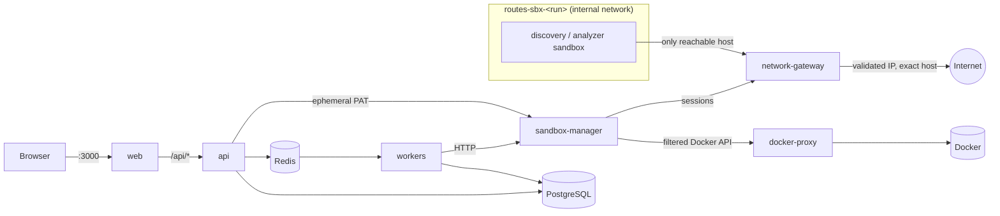

# Architecture

## Services

| Service | Image | Role | Networks |
|---|---|---|---|
| `web` | routes/web | Next.js UI. Proxies `/api/*` to the API so cookies stay first-party. Only service published to the host (127.0.0.1). | frontend |
| `api` | routes/api | FastAPI REST API: auth, projects, integrations, assessments, results. Enqueues jobs. | frontend, backend |
| `migrate` | routes/api | One-shot: `alembic upgrade head`, marks assessments interrupted by a restart as failed, purges staged uploads. | backend |
| `worker-discovery` / `worker-source` | routes/worker | RQ workers. Request sandbox runs over HTTP, mirror progress into PostgreSQL, validate and persist results. **No Docker access.** | backend |
| `sandbox-manager` | routes/sandbox-manager | Creates per-run networks, gateway sessions and disposable containers; supervises them and always cleans up. Holds private-repo tokens in memory only. | backend, docker-control, gateway-control |
| `docker-proxy` | routes/docker-proxy | The only container with the Docker socket. Default-deny Docker API filter. | docker-control |
| `network-gateway` | routes/network-gateway | Egress proxy and GitHub import path for sandboxes. Enforces destination policy. | gateway-control, egress (+ per-run networks) |
| `postgres`, `redis` | upstream | Data and job queues. | backend |
| `discovery-image`, `analyzer-image` | sandbox images | Build-only services; they exit immediately. Sandbox containers are started only by the Sandbox Manager. | none |
| `sample-site` | python | `testing` profile only: deterministic site for tests. | egress |

`backend`, `docker-control`, `gateway-control` and every `routes-sbx-*` network are Docker `internal` networks: they have no route to the outside world. Only the gateway is attached to the `egress` network.

## Assessment lifecycle

1. `POST /projects` validates the URL, records the authorisation statement and creates an **assessment** with child jobs `discovery` and `results` (plus `source` when code is connected). A partial unique index allows only one active assessment per project, so repeated clicks cannot start duplicate work.
2. The API enqueues RQ jobs whose job id equals the `assessment_jobs.id` (queue-level de-duplication). Connecting a source while discovery runs attaches a `source` job to the same assessment.
3. A worker marks its job `running` (re-delivered jobs that are already terminal are ignored), asks the Sandbox Manager for a run, and polls it every 2 s. Sandbox progress events become `stage`/`message` on the job, which is what the UI polls.
4. The Sandbox Manager:
   - discovery: creates an internal network `routes-sbx-<id>`, connects the gateway, opens a gateway *web session* scoped to the exact hostname and the run's subnet, then starts the discovery container with a proxy URL;
   - GitHub source: same, but with a *github_import* session (no general egress);
   - ZIP source: no network at all (`NetworkMode: none`), the upload mounted read-only via a per-upload volume subpath;
   - always removes the container, disconnects the gateway, removes the network, closes the gateway session (collecting a destination log) and deletes staged uploads, on success, failure, timeout or cancellation.
5. The worker validates the sandbox JSON against `routes_shared.contracts` (lengths, list caps), redacts it again and replaces the job's rows in one transaction.
6. When every work job is terminal, `maybe_finalize` (row lock) enqueues the `results` job exactly once. It correlates source routes with website endpoints (only if the developer confirmed the repository matches), sets the final status, then applies retention.

### Status rules

| Discovery | Source | Assessment |
|---|---|---|
| completed | completed / absent | `completed` |
| completed | failed | `partially_completed` |
| failed | completed | `partially_completed` |
| failed | failed / absent | `failed` |
| any, with cancel requested | | `cancelled` |

Intermediate states: `queued` → `discovering` / `analysing` / `running` (derived from which child is running).

## Discovery engine (`services/discovery`)

HTTP-first breadth-first crawl (httpx through the gateway) with manual, scope-checked redirects:

1. root fetch (unreachable gives a fatal result and a failed job with a clear message)
2. `/.well-known/routes.json` manifest: ≤16 KB, strict schema, only known keys retained, untrusted
3. `robots.txt` (crawl policy only, never treated as integration evidence) and sitemaps (`defusedxml`)
4. up to **25 HTML pages**, exact hostname, de-duplicated by normalised URL, skipping assets and destructive-looking links (`logout`, `delete`…); failures are recorded per page
5. extraction (lexbor): links, forms and fields (never submitted), query parameters, scripts, sign-in and registration heuristics
6. Playwright Chromium rendering only for pages that look like JavaScript shells (≤8 per run); the browser aborts any non-GET or out-of-scope request
7. JavaScript bundles (≤30): `fetch`, axios, XHR and API-path string references
8. OpenAPI/Swagger probing on a fixed list of paths
9. technology detection from headers, cookies, markup, generator tags, script URLs and bundle contents. Every technology keeps its evidence; the database is only reported from explicit database error output.

## Source analyzer (`services/source_analyzer`)

1. **Acquisition:** GitHub tarball via the gateway import path, or the ZIP mount. Safe extraction into a `noexec` tmpfs (see SECURITY.md). Dependency and build folders are excluded; manifests and lockfiles are kept.
2. **Profiling:** languages, `package.json` dependencies, lockfiles, Next.js/TS config and path aliases, database libraries, environment variable *names*. Support verdict: `supported` (Next.js + pg), `partial` (Next.js without pg), `unsupported` (anything else, with a basic profile).
3. **Structure (tree-sitter):** App Router `route.(js|ts)` exported method handlers, Pages Router `pages/api` default handlers and their `req.method` branches. Route groups and parallel slots are removed from paths.
4. **Data flow (custom Python):** seeds taint from the request object and route context, then propagates through declarations, destructuring, assignments, `+=`, template literals, concatenation and method calls. Numeric conversion, allow-list ternaries and pg escaping functions act as sanitisers. pg sinks are resolved through imports (`new Pool`/`Client`, `pool.connect()`, exported pools, query wrappers, SQL-building helpers, with tsconfig aliases).
5. **Semgrep** (offline, bundled rules): secrets, `child_process` with dynamic commands, `eval`/`Function`, TLS verification disabled, wildcard CORS, secret-looking `NEXT_PUBLIC_*`, insecure cookie flags, weak hashes, `dangerouslySetInnerHTML`.
6. **Repository matching evidence:** homepage, README/config URLs, CNAME, vercel aliases and source references to the submitted hostname. The developer decides.

## Frontend (`apps/web`)

Next.js App Router with client-side data fetching (`hooks/use-api.ts`) and polling while assessments are active. `lib/api.ts` sends the CSRF header automatically. Design tokens live in `styles/globals.css`; shadcn/ui primitives in `components/ui` are restyled to the ROUTES system (dense tables, hairline borders, one accent colour, severity bars instead of coloured pills).

## Extension points for later phases

- `FindingStatus.CONFIRMED` exists but is never produced in Phase 1.
- New sandbox kinds go in `policies/limits.py` with an image allow-listed in the Docker proxy.
- New detection engines produce `routes_shared.contracts.Finding` objects; persistence and UI are already generic.
