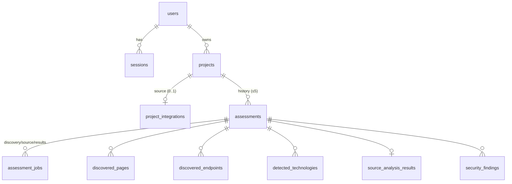

# Database

PostgreSQL 16, SQLAlchemy 2 models in `services/api/app/models`, Alembic migrations in `services/api/alembic/versions`. All primary keys are UUIDs; every table has `created_at`/`updated_at` (timestamptz).



| Table | Key columns | Constraints and indexes |
|---|---|---|
| `users` | email, password_hash (Argon2id), display_name | unique `lower(email)` |
| `sessions` | user_id, token_hash (SHA-256 of the cookie token), expires_at, last_seen_at, user_agent | unique token_hash; idx user_id, expires_at |
| `projects` | owner_id, name, website_url, hostname, authorised_at, authorisation_statement | idx (owner_id, created_at) |
| `project_integrations` | kind (`github_public`/`github_private`/`zip`), repo owner/name/ref, upload filename/size/sha256, match_status, match_evidence | unique project_id. **No token column.** |
| `assessments` | project_id, status, target_url, source_kind/label, manifest_detected/data, discovery_summary (JSONB), cancel_requested, error, started/finished_at | idx (project_id, created_at), status; **partial unique index on project_id where status is active** |
| `assessment_jobs` | assessment_id, kind, status, stage, message, stages_completed, attempts, error, details | unique (assessment_id, kind) |
| `discovered_pages` | url, status_code, title, content_type, depth, rendered, is_login, is_registration, counts, error | unique (assessment_id, url) |
| `discovered_endpoints` | method, url, path, origin, parameters, details, evidence, page_url | idx (assessment_id, origin) |
| `detected_technologies` | name, category, version, confidence, source, evidence | unique (assessment_id, name, source) |
| `source_analysis_results` | support_status/reason, framework, runtime, profile, routes, db_interactions, input_sources, config_refs, env_var_names, match_evidence, warnings | unique assessment_id |
| `security_findings` | type, status, severity, confidence, title, file, line, endpoint, method, rule_id, plain_description, evidence_summary, technical_details, recommendation, fingerprint | unique (assessment_id, fingerprint); idx (assessment_id, severity) |

All child tables use `ON DELETE CASCADE` to `assessments`, which cascades to `projects` and `users`.

## What is never stored

Passwords (only Argon2id hashes), session tokens (only hashes), GitHub tokens, HTML bodies, repository files, uploaded archives, or secret values found in code. Evidence strings are redacted in the sandbox and again in the worker before insertion.

## Retention

After an assessment is finalised, `lifecycle.apply_retention` keeps the 5 newest assessments of the project (`ASSESSMENT_HISTORY_LIMIT`) and deletes older *non-active* ones with their dependent rows. The project and its integration are never removed by retention.

## Migrations

```bash
docker compose run --rm migrate                                    # apply (also runs on every `up`)
docker compose run --rm --no-deps -v ./services/api:/srv/api migrate \
  alembic revision --autogenerate -m "describe change"             # create
```
