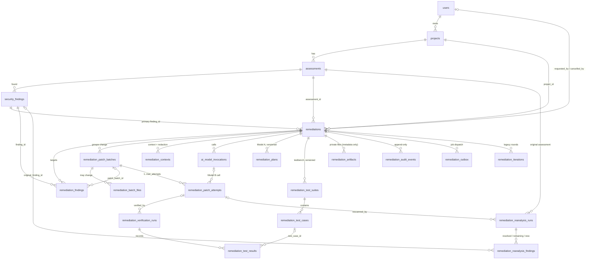

# Remediation persistence: data model, workflow and verification

Status: implemented on top of `feat/remediation-loop` (migration `0008_remediation_lifecycle`).
Scope: the web stack's PostgreSQL database (`services/api`, `services/worker`). The CLI's SQLite store
(`packages/storage`) is unchanged; see [Known limitations](#known-limitations-and-deferred-work).

## 1. Audit of the existing database (before this change)

| Area | Finding |
|---|---|
| Engine / ORM / migrations | PostgreSQL 16, SQLAlchemy 2.0 declarative models (`services/api/app/models`), Alembic (`services/api/alembic`, linear revisions `0001`–`0007`). The `migrate` compose service runs `alembic upgrade head` and the restart reconciliation (`app/cli.py`). |
| Conventions | UUID primary keys (`IdMixin`), `created_at`/`updated_at` (`TimestampMixin`), a naming convention for constraints and indexes (`ix_`, `uq_`, `ck_`, `fk_`, `pk_`), `String` status columns validated by `routes_shared.enums` (no PG enum types), JSONB for flexible data. |
| Ownership / tenancy | Single-owner model: `projects.owner_id → users.id`. Every API read goes through `owned_assessment()` (`app/services/projects.py`). No organisations. |
| Core entities | `users`, `sessions`, `projects`, `project_integrations` (one source per project; never stores credentials), `assessments`, `assessment_jobs`, `discovered_pages`, `discovered_endpoints`, `detected_technologies`, `source_analysis_results`, `security_findings` (content fingerprint unique per assessment, `end_line`, `snapshot` JSONB). |
| Remediation (from the branch) | `remediations` (one row per *finding*: `finding_id`, coarse `status`, `finding_status`, `cancel_requested`, `error`) and `remediation_iterations` (per round: `candidate_hash`, **`candidate_code` as Text**, `test_results`/`rescan_diff` JSONB, `fix_source`). |
| Job persistence | RQ on Redis; `assessment_jobs` rows; RQ job id = row id. Remediation enqueued straight from the API after commit (lost if Redis was down). |
| Gaps found | No project/assessment link or actor on a run; no workflow stage or transition history; no model-invocation record; Model A's plan and testbench never persisted; no attempt numbering or limit in the DB (default `MAX_ROUNDS=5`); rounds written only **after** the loop finished (a crash lost them); verification runs, test results and reanalysis kept only as JSON blobs; raw candidate source in an ordinary column; the default `fake` sandbox runner's canned results could be reported as `succeeded`; no audit trail; no idempotency or concurrency control beyond a row lock at job start. |
| Merge issues found | `worker-remediate` had lost `profiles: ["web"]` (it would have started with the CLI engine and failed on the missing `migrate` dependency); `source_analyzer/main.py` had lost `result["input_sources"]` in the conflict resolution; `worker/tests/test_jobs.py` lost an import; the analyzer could put raw secret values into finding snapshots (4 failing analyzer tests on the branch). All fixed. |

### Integration decision

`remediations` already *is* a remediation run (one execution with its own id, status and timestamps), so it
was extended rather than duplicated. Its id, `finding_id` (now "the primary finding"), `status`,
`finding_status`, `cancel_requested` and `error` keep their meaning for the existing frontend. Findings
are always referenced by foreign key; nothing from `security_findings` is copied except the
severity / confidence / fingerprint / rule snapshot needed for historical reporting.

## 2. Entity-relationship diagram

## 3. Tables

### Modified existing tables

| Table | Change |
|---|---|
| `remediations` | Added `project_id`, `assessment_id` (FK, CASCADE), `requested_by`, `cancelled_by` (FK users, SET NULL), `actor_type`, `stage`, `stage_entered_at`, `verdict`, `verdict_reason`, `failure_category`, `source_kind`, `source_ref`, `source_commit_sha`, `max_attempts`, `attempts_total`, `cancelled_at`, `version`, `lease_owner`, `lease_expires_at`, `recovery_count`, `correlation_id`, `idempotency_key`. Checks `max_attempts BETWEEN 1 AND 10`, `attempts_total >= 0`. Nothing dropped or renamed. |
| `remediation_iterations` | Unchanged schema. Still written (one row per patch attempt) for older clients; `candidate_code` is no longer filled. The API serves candidate code from the artifact store instead. |
| `security_findings` | Unchanged by 0008. |

### New tables

| Table | Purpose | Key constraints |
|---|---|---|
| `remediation_findings` | Findings a run targets; **the canonical per-run resolution** (`resolution`, `resolution_reason`, `gates`, `residual_risk`) plus the severity/confidence/fingerprint/rule snapshot | unique `(remediation_id, finding_id)`; partial unique `finding_id WHERE is_active` (one active run per finding); check on `resolution` |
| `remediation_patch_batches` | Logical unit of change; `max_attempts`, `attempts_used`, `depends_on_batch_id` | unique `(remediation_id, sequence)`; `attempts_used <= max_attempts`; status check |
| `remediation_batch_files` | Files a batch may change | unique `(remediation_id, file_path)`: two batches of one run can never overwrite each other |
| `remediation_contexts` | Selected files / lines, extraction method, size, content hash, redaction engine + ruleset version, verification result, placeholder count, expiry | FK to the redacted snapshot artifact |
| `ai_model_invocations` | Role (`analysis` / `patch_generation`), provider (endpoint host, so a new provider needs no schema change), model, served model version, prompt template version, input/output SHA-256 and artifact refs, status (`started/succeeded/failed/invalid_output/blocked`), timing, token usage, error category, sanitised detail, correlation id | unique `(remediation_id, sequence)`; role and status checks. **No prompt, response or key columns.** |
| `remediation_plans` | Model A output, versioned. Only what Model A returns is stored (today: the fix strategy); `root_cause`, `expected_behaviour`, ... stay NULL rather than being invented | unique `(remediation_id, version)` |
| `remediation_test_suites` | Testbench versions: type, generation method, validation status, baseline status, artifact | unique `(remediation_id, version)`; checks |
| `remediation_test_cases` | Each test of a suite: category, expected behaviour, baseline outcome, validation status, **visibility** (`hidden` by default: Model B never receives testbench code) | unique `(suite_id, name)` |
| `remediation_patch_attempts` | Every Model B generation / correction: attempt number, limit, invocation, plan version, unified-diff patch artifact + SHA-256, candidate artifact, files changed, generation / validation / verification status, failure reason, idempotency key, link to the legacy iteration row | unique `(batch_id, attempt_no)`; **check `1 <= attempt_no <= max_attempts`**; unique `idempotency_key` |
| `remediation_verification_runs` | Every sandbox execution (`baseline`, `gate_known_bad`, `candidate`, `rescan`, `combined_rescan`): sandbox id, runner, profile, **evidence grade** (`sandbox`/`simulated`), build / startup / database / functional / security / overall status, failure category, log artifact | unique `idempotency_key`; checks |
| `remediation_test_results` | Every executed test: outcome (`passed/failed/error/skipped/inconclusive`), expected vs actual, matches-expectation flag, sanitised error | unique `(verification_run_id, test_name)` |
| `remediation_reanalysis_runs` | Independent rescan of the patched code tied to the original assessment: counts before / after / resolved / remaining / new, evidence grade, scope (`batch` / `combined`) | |
| `remediation_reanalysis_findings` | Per-fingerprint traceability from each original finding to its post-remediation state (`resolved/remaining/new`) | unique `(reanalysis_id, fingerprint)` |
| `remediation_artifacts` | Metadata of files in the private artifact store: kind, SHA-256, size, storage key, redaction status, contains-source flag, expiry, deletion time | unique `(remediation_id, kind, sha256)` |
| `remediation_audit_events` | Append-only history: global `seq` (identity), event type, entity, actor, previous / new state, correlation id, sanitised `metadata` | trigger refuses UPDATE, and DELETE unless the parent run is being deleted |
| `remediation_outbox` | Transactional outbox for queue publication | unique `dedupe_key`; partial index on pending rows |

### Indexes

Every foreign key is indexed (naming convention `ix_<table>_<column>`). Composite / partial indexes for
the common queries: `remediations (project_id, created_at)`, `(assessment_id, created_at)`,
`(status, created_at)`, `correlation_id`, partial unique `(project_id, idempotency_key)`;
`remediation_audit_events (remediation_id, seq)`, `correlation_id`;
`remediation_verification_runs (remediation_id, started_at)`; `ai_model_invocations (provider, model,
started_at)` for cost analysis; `remediation_artifacts (expires_at) WHERE deleted_at IS NULL`;
`remediation_outbox (available_at) WHERE status = 'pending'`.

JSONB is used only for genuinely flexible data: `gates`, `coverage`, `resource_usage`, `engine_versions`,
audit `metadata`, file/symbol lists of a context or plan, and the legacy iteration blobs.

## 4. Where each part of the workflow is persisted

| Workflow step | Stage(s) | Persisted in |
|---|---|---|
| Start for selected findings | `queued` | `remediations`, `remediation_findings`, `remediation_patch_batches` + `remediation_batch_files`, `remediation_outbox`, audit `remediation_requested` |
| Worker picks it up | (lease) | `remediations.lease_owner/lease_expires_at/version`, audit `worker_claimed` / `worker_resumed` |
| Context extraction | `preparing_context` | `remediation_contexts` (+ `context_snapshot` artifact), audit `context_extracted` |
| Redaction + independent verification | `redacting` | `remediation_contexts.redaction_*`, audit `redaction_completed` / `redaction_failed` |
| Model A | `analysis` | `ai_model_invocations` (role `analysis`, `model_input`/`model_output` artifacts) |
| Plan | `planning` | `remediation_plans` (+ `plan` artifact) |
| Testbench | `generating_tests` | `remediation_test_suites` (+ `testbench` artifact) |
| Baseline on the original code, known-bad-fix gate | `baseline_verification` | `remediation_verification_runs` (`baseline`, `gate_known_bad`), `remediation_test_results`, `remediation_test_cases` |
| Testbench validation | `validating_tests` | `remediation_test_suites.validation_status/baseline_status`, audit `testbench_validated` / `testbench_rejected`, `original_vulnerability_reproduced` |
| Model B patch | `generating_patch` | `remediation_patch_attempts` (number allocated under a batch lock), `ai_model_invocations` (role `patch_generation`) |
| Patch validation (diff structure, paths, batch file scope) | `validating_patch` | `remediation_patch_attempts.validation_status/failure_reason`, `patch` + `candidate` artifacts, audit `patch_generated` / `patch_rejected` |
| Sandbox tests | `testing` (`building` when a runner builds the app) | `remediation_verification_runs` (`candidate`), `remediation_test_results` |
| Failure analysis / retry | `analysing_failure`, `retrying` | attempt `verification_status` + `failure_reason`, legacy `remediation_iterations`, audit `patch_attempt_failed` |
| Post-remediation static analysis | `post_remediation_analysis` | `remediation_reanalysis_runs` + `remediation_reanalysis_findings` (per batch, and `combined` across batches) |
| Final decision | `completed` / `human_review` / `inconclusive` / `failed` / `cancelled` | `remediation_findings.resolution/gates/residual_risk`, `remediations.verdict/verdict_reason/status/finding_status`, audit `remediation_completed` (and `human_review_requested`) |
| Report | — | `GET .../remediations/{id}/report`, built only from the rows above |

## 5. State machine and verdicts

Defined once in `packages/shared/routes_shared/remediation_workflow.py`:

- **Transitions.** Forward edges are listed explicitly. Any active stage may end as `failed`, `cancelled`,
  `inconclusive` or `human_review`, but only `post_remediation_analysis` may reach `completed`. A crashed
  run may only resume at `preparing_context`. Invalid transitions raise `InvalidTransition`, and every
  accepted one is written to the audit trail with its previous and new state.
- **Per-finding resolution** (`decide_finding`). `verified_fixed` requires all five gates:
  1. the testbench was validated;
  2. the baseline reproduced the vulnerability;
  3. the candidate passed every test;
  4. an independent rescan no longer reports the finding, with no new finding (including the combined
     rescan of a multi-batch run);
  5. every one of these results came from a real sandbox (`evidence_grade = sandbox`).

  Otherwise:
  - `inconclusive` when no testbench could be validated, setup is unsupported, or the evidence is
    simulated;
  - `human_review` when attempts are exhausted, candidates oscillate, or redaction could not be verified;
  - `failed` for infrastructure errors;
  - `cancelled` when the run was cancelled.
- **Run verdict** (`decide_run`):
  - `verified_fixed` when every finding is fixed;
  - `partially_remediated` when only some are;
  - otherwise `human_review` / `inconclusive` / `failed` / `cancelled`.

  The coarse legacy `status` is derived from the verdict:
  - `succeeded` only for `verified_fixed`;
  - `needs_human_review` for `partially_remediated`, `human_review` and `inconclusive`;
  - `failed` and `cancelled` unchanged.
- The verdict is computed by `remediation_store.finalize()` **from the persisted evidence rows**. Worker
  hints (oscillation, unsupported setup, redaction failure) can only explain a non-fix and never satisfy a
  gate. No percentage score exists anywhere.

## 6. Transactions, concurrency and reliability

- Every store function is one atomic transaction. The worker opens a fresh short session per store call,
  so **no transaction is open during a model or sandbox call**.
- **Lease.** `claim()` is a conditional `UPDATE ... RETURNING`: only one worker can hold a run. A
  redelivered job finds the lease held, or the run finished, and does nothing. An expired lease (crashed
  worker) lets another worker resume. Unfinished attempts are marked `abandoned` and **still count**, so a
  crash loop can never exceed the attempt limit. After `REMEDIATION_MAX_RECOVERIES` resumptions (default
  2) the run is failed, with failure category `infrastructure`.
- **Row locks.** Every state change locks the run row (`SELECT ... FOR UPDATE`), checks the lease and the
  state machine, and increments `version`. Attempt numbers are allocated under a lock on the batch row.
- **Idempotency.**
  - Patch attempts are keyed `batch:attempt_no` and verification runs `attempt:purpose`.
  - Artifacts are content-addressed.
  - API creation accepts an optional `idempotency_key`, unique per project.
  - Asking again for one finding returns its active run.
- **Outbox.** Run creation and recovery write `remediation_outbox` rows in the same transaction. Rows are
  published after the API request, when worker-remediate starts, and after every remediation job. A Redis
  failure leaves the row pending, retried with backoff. No new broker was introduced.
- **Restart.** `app/cli.py` (the `migrate` service) re-dispatches interrupted runs through the outbox and
  purges expired artifacts. The full history is in PostgreSQL and the artifact volume, never in worker
  memory.

## 7. Security, privacy and retention

- **Ownership.** All endpoints resolve the run *through* an assessment the caller owns. Another user gets
  404 on every remediation endpoint, including artifact downloads (tested). Artifacts are additionally
  looked up by `(run, artifact id)`. No second tenancy mechanism was added.
- **No source code in ordinary columns.** Redacted context, model input/output, testbenches, patches,
  candidates and sandbox logs go to the private artifact store (`ARTIFACTS_DIR`, a dedicated volume
  `routes_remediation_artifacts` mounted only in `migrate`, `api` and `worker-remediate`, never in a
  sandbox):
  - files are mode `0600` in `0700` directories;
  - they are immutable and content-addressed;
  - their hash is verified on read;
  - downloads are served `no-store`.
- **Nothing unredacted is stored or sent.**
  - Every artifact is re-checked with `routes_shared.redaction.unredacted_secret_count` before it is
    written; content that still holds a secret-like value is refused, not stored.
  - Before *every* model request, the worker runs the same independent check on the outgoing messages. A
    hit records a `blocked` invocation, sends nothing, and ends the run in `human_review`.
  - Snapshots are masked when the analyzer builds them, and findings that *are* a committed secret get no
    snapshot.
- **No credentials anywhere.** Provider API keys exist only in the worker's environment and its HTTP
  client. Invocation rows hold hashes and usage only, and the tests assert the key appears in no row and no
  artifact. Sanitised error details pass through `redact_text`. Audit metadata is redacted and capped at
  4 KB. No GitHub PAT or production database credential is involved.
- **Redacted code is still confidential.** It is stored only in the private volume, with retention
  `REMEDIATION_ARTIFACT_RETENTION_DAYS` (default 30). Expired files are deleted and their rows marked
  `deleted_at`. Directories of deleted runs are swept. `REMEDIATION_RETAIN_MODEL_IO=false` stops retaining
  model input/output; the hashes are still recorded.
- **History follows the assessment.** Deleting a project or assessment, including the existing
  "5 assessments per project" retention, cascades to its remediation runs and history. The audit trigger
  allows exactly this and refuses any other deletion or update.
- Docker, docker-proxy and network-gateway policies are untouched.

## 8. API

Under `/api/v1/assessments/{assessment_id}`:

| Method & path | Purpose |
|---|---|
| `POST /findings/{finding_id}/remediate` | *(existing)* start or return the active run for one finding |
| `GET /findings/{finding_id}/remediations/{id}` | *(existing)* run view, now with stage, verdict, findings |
| `POST /findings/{finding_id}/remediations/{id}/cancel` | *(existing)* cancel |
| `POST /remediations` | start one run for several findings (`finding_ids`, optional `idempotency_key`); findings in the same file are refused (`overlapping_findings`) |
| `GET /remediations?limit&offset` | history, paginated, newest first |
| `GET /remediations/{id}` | run view |
| `GET /remediations/{id}/contexts` · `/plans` · `/testbench` · `/batches` · `/attempts` · `/invocations` · `/verifications` · `/reanalysis` | lifecycle records |
| `GET /remediations/{id}/audit?after_seq&limit` | audit trail, keyset-paginated |
| `GET /remediations/{id}/report` | report built from the records |
| `GET /remediations/{id}/artifacts/{artifact_id}` | owner-only download |
| `POST /remediations/{id}/cancel` | cancel |

The existing response fields keep their names and meanings. New fields are additive. The frontend type
gained the new fields, and the panel shows the stage or verdict and the attempt count as text.

## 9. Migration `0008`

- Additive only. It adds columns as nullable, backfills them, then sets NOT NULL; it creates tables,
  indexes and the trigger.
- Backfill of existing runs:
  - project and assessment come from the finding;
  - stage and verdict come from the legacy status;
  - one `remediation_findings` row per run;
  - one `migrated` audit event per run.
- Legacy `succeeded` runs are **not** relabelled `verified_fixed`: they have no recorded evidence. They get
  stage `completed`, verdict NULL and resolution `inconclusive`, with an explanation.
- If the legacy data has several pending runs for one finding, only the newest stays active.
- Downgrade restores the exact 0007 schema and every pre-0008 value. It loses everything recorded after
  the upgrade (attempts, plans, audit), so take a backup before downgrading. Artifact files are not
  touched by either direction.

**Verified against a copy of the existing database.** The live database (15 projects, 32 assessments, 75
findings, at revision 0001) was copied with `pg_dump` into a throwaway PostgreSQL container. On that copy:

- it was upgraded to 0007 and seeded with legacy remediation rows (one per status, plus a duplicate pending
  run);
- it was upgraded to 0008, with the results checked (§10);
- it was downgraded to 0007 and upgraded again.

The live database itself was **not** migrated.

## 10. Verification results

All runs used PostgreSQL 16 in throwaway containers; nothing ran against the live stack.

| Suite | Result |
|---|---|
| Migration on the copy of the live database | Pre-existing data checksums (users, projects, assessments, findings, remediations, iterations) identical after upgrade, after downgrade and after re-upgrade. `pg_dump -s` after downgrade identical to the 0007 schema. `alembic check`: no difference between models and migrated schema. The audit trigger refused UPDATE and direct DELETE and allowed the cascade. |
| `services/api/tests` (incl. `test_migration_0008.py`) | 52 passed |
| `services/worker/tests` (incl. 24 remediation job/persistence tests) | 82 passed |
| `packages/shared/tests/test_remediation_workflow.py` | 15 passed |
| `packages/shared`, `packages/core`, `packages/storage`, `apps/cli` tests | 173 passed |
| `services/source_analyzer/tests` | 76 passed (4 were failing on the branch before; fixed) |
| `apps/web` `tsc --noEmit` | passed |

Worker scenarios covered: a full successful lifecycle; a failed first patch followed by a correction; the
three-attempt maximum (enforced by the store and by a DB CHECK); oscillation; partial remediation of two
findings; a combined rescan that catches a cross-batch regression; a testbench that never validates;
reanalysis with new findings; cancellation (claimed and unclaimed); missing snapshot and missing source;
provider failure; duplicate delivery; two workers; a crashed worker that is resumed; too many recoveries;
outbox retry; transaction rollback; the one-active-run-per-finding index; no credentials or source in rows;
the pre-send redaction guard; append-only audit; cascade on assessment deletion.

Model transports and sandbox results in these tests are scripted. The scripted runner that declares
`sandbox` evidence exists only to exercise the verdict rules. No test claims that a real sandbox verified a
real fix.

## Known limitations and deferred work

- **Real verification** now runs in the Build & Run engine (`SANDBOX_RUNNER_KIND=build_run`); see
  [REMEDIATION_VERIFICATION.md](REMEDIATION_VERIFICATION.md). The `fake` runner remains `simulated`
  evidence and can never produce `verified_fixed`.
- **Commit SHA** is now recorded for GitHub assessments (from the archive's pax header) and pins every
  verification. Assessments made before this change have none, so their runs end `inconclusive` until the
  assessment is re-run.
- **No ZIP-sourced rescans in the web stack.** The web stack does not retain the uploaded ZIP, so
  ZIP-sourced projects end `inconclusive`. A retained archive verified by SHA-256 is supported by the
  runner (used by the CLI-side end-to-end test).
- **Plans in build-run mode** store the structured fields Model A returns: root cause, expected
  behaviour, regression risks and required context. Fields it does not return stay NULL. The legacy JS
  testbench mode is unchanged, so its replay caches stay valid.
- **Patches are derived diffs.** Model B returns bounded replacement code for the snapshot region (the
  branch's design, validated by `validate_fix`). ROUTES derives the unified diff from it, then validates
  and stores that diff. Model B never supplies a diff or a command.
- **One finding per batch.** The loop handles one finding per batch, so a run refuses two findings in the
  same file rather than letting one silently overwrite the other.
- **`security_findings.snapshot` stays in a database row.** It still holds the redacted function excerpt
  (≤ 2000 characters) in JSONB. This predates this change and is required by the existing source job.
  Moving it to the artifact store is deferred.
- **Worker tests are not in CI.** `services/worker/tests` are not run by the CI workflow; their conftest
  expects the container layout (`/srv/api`).
- **The CLI has no remediation commands.** The CLI's SQLite store has none and is unchanged.
- **`worker-remediate` no longer has direct internet access.** Its only exit is the gateway's fixed
  `models` route: HTTPS to `MODEL_EGRESS_HOSTS` only, and no route at all without `MODEL_EGRESS_TOKEN`.
